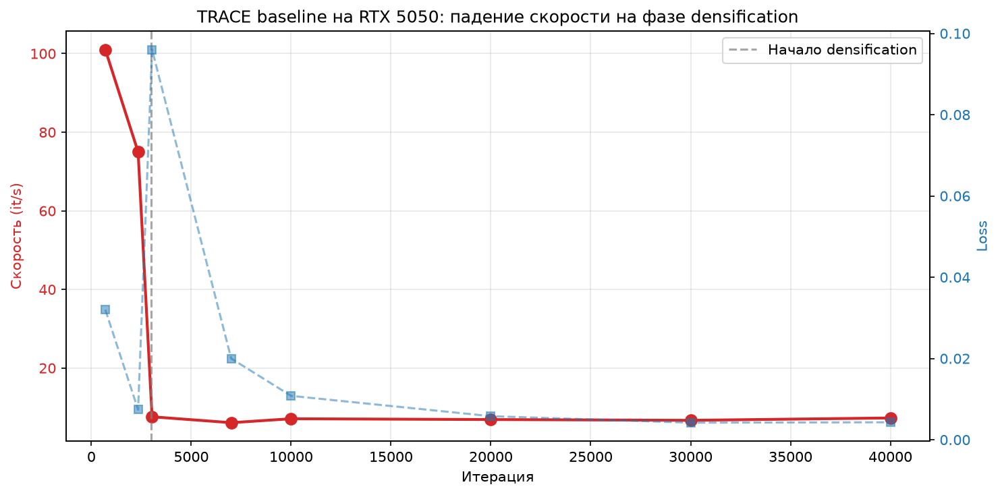
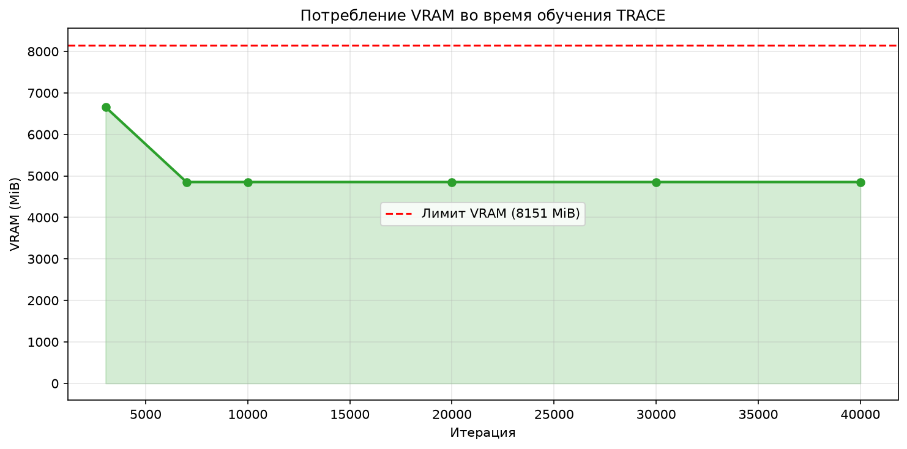
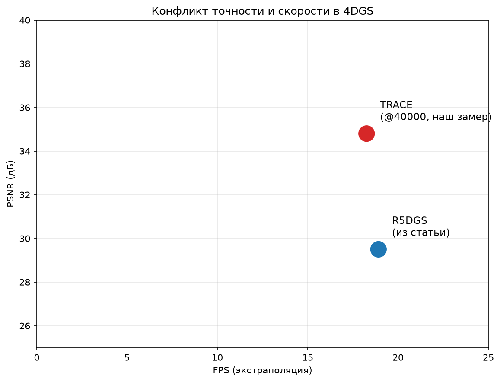
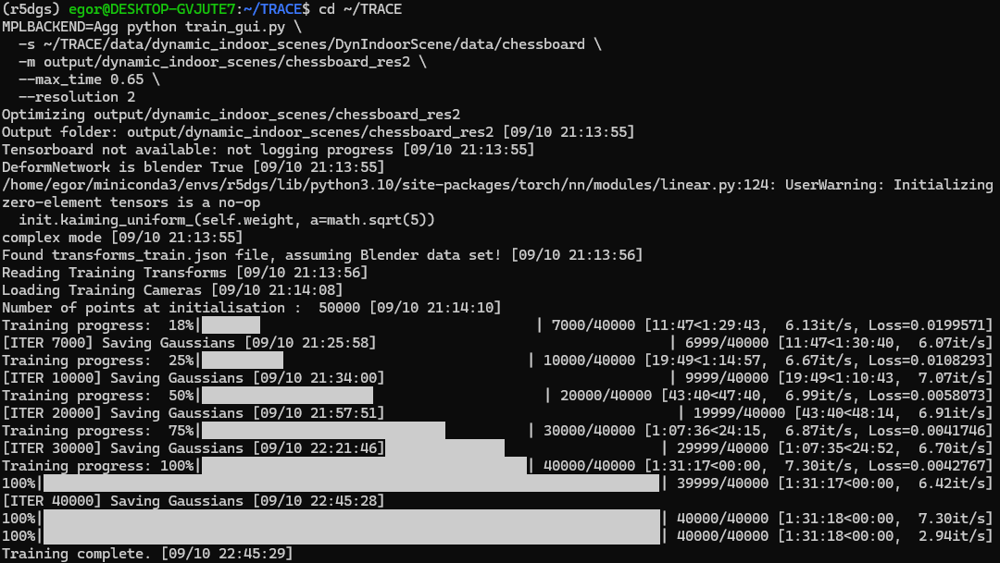

# Трёхмерная и пространственно-временная реконструкция: анализ открытой проблемы, гипотеза и практическая валидация

**Тестовое задание для отбора в лабораторию BE2R Lab (ИТМО)**

---

## 1. Введение

**Направление:** трёхмерная и пространственно-временная реконструкция (4D scene reconstruction).

**Обоснование выбора.** Направление соответствует одной из шести тем отбора и активно разрабатывается в лаборатории BE2R Lab (ИТМО) под руководством С. А. Колюбина. Это даёт доступ к свежим, верифицируемым источникам (2023–2026) и возможность опереться на практические результаты коллег при формулировке открытой проблемы.

**Тезис работы.** На основе анализа трёх свежих публикаций (R5DGS, GSplatLoc, обзор Gong et al.) выявляется открытая проблема — **конфликт между физической правдоподобностью экстраполяции и вычислительной эффективностью при масштабировании 4D-реконструкции на объектно-богатые сцены** — и формулируется гипотеза для её преодоления через иерархическую rigid-body схему с многоуровневой семантической группировкой.

**Практическая валидация.** Гипотеза частично проверена эмпирически: воспроизведён baseline TRACE на сцене `chessboard` из датасета Dynamic Indoor Scene на GPU RTX 5050 (8 ГБ VRAM) в окружении WSL2 + CUDA 12.8 + PyTorch 2.11. Финальные метрики (чекпоинт 40000, обучение завершено): **PSNR 34.80 дБ, SSIM 0.9659, LPIPS 0.0328 @ 18.26 FPS** на экстраполяции. Экспериментально подтверждено, что **вычислительная сложность O(N) per-particle динамики** является ключевым ограничением при масштабировании, что напрямую обосновывает актуальность гипотезы.

**Структура репозитория:**

- `papers/` — конспекты трёх ключевых статей;
- `analysis/` — сравнительная таблица методов и систематизация открытых проблем;
- `hypothesis/` — формулировка гипотезы и план проверки;
- `notebooks/practical_validation.ipynb` — практическая часть: воспроизведение baseline, замеры, графики;
- `results/` — сырые логи экспериментов и графики;
- `references.bib` — библиография.

---

## 2. Обзор статей

### 2.1. R5DGS

**R5DGS: Semantic-Aware 4D Gaussian Splatting with Rigid Body Constraints for Efficient Dynamic Scene Reconstruction**
Gridusov, Popov, Kolyubin (BE2R Lab, ITMO). ECCV 2026 Workshop; arXiv:2605.25909.
Ссылки: https://arxiv.org/abs/2605.25909 · https://github.com/be2rlab/r5dgs

**Задача.** Эффективная 4D-реконструкция динамических сцен с сохранением физической правдоподобности экстраполяции.

**Метод.** Расширение физически-обоснованного 4D Gaussian Splatting (на базе TRACE). Два ключевых механизма: (1) компактные 16-мерные Identity Encoding векторы для группировки гауссианов в объекты без 3D-аннотаций; (2) rigid-body ограничения при экстраполяции — динамика вычисляется только для репрезентативных гауссианов (9–12 на объект), движение остальных propagated через относительные трансформации. Дополнительно — offline CLIP-lookup таблица для open-vocabulary запросов.

**Результат (по данным статьи).** Ускорение на **+11 FPS относительно 5DGS** (промежуточной версии без rigid-body constraint); сложность инференса снижена с O(N) до O(K), где K — число объектов. При этом PSNR ниже, чем у полного TRACE: **28–31 дБ против 34.80 дБ** (наш замер TRACE @40000).

**Ограничение.** Работает при K < ~40 объектов; не тестировалось на длинных последовательностях и сценах с большим числом мелких объектов.

**Статус кода на момент выполнения работы.** Репозиторий `be2rlab/r5dgs` содержит **только README**. Публичная реализация отсутствует. Поэтому практическая валидация выполнена на **baseline TRACE** — открытом фреймворке, поверх которого надстраивается R5DGS.

---

### 2.2. GSplatLoc

**GSplatLoc: Grounding Keypoint Descriptors into 3D Gaussian Splatting for Improved Visual Localization**
Sidorov, Mohrat, Gridusov, Rakhimov, Kolyubin. IROS 2025; arXiv:2409.16502.
Ссылки: https://arxiv.org/abs/2409.16502 · https://gsplatloc.github.io

**Задача.** Визуальная локализация на основе представления сцены через 3D Gaussian Splatting.

**Метод.** Интеграция дескрипторов ключевых точек (XFeat) в 3DGS. Двухстадийный пайплайн: coarse pose estimation через 2D-3D соответствия с PnP/RANSAC, затем refinement через photometric warp loss. XFeat обеспечивает робастность в динамических сценах.

**Результат.** Робастность в динамических сценах; <1 сек на refined pose; benchmark’и Cambridge Landmarks (outdoor) и 7Scenes (indoor).

**Ограничение.** Метод решает задачу локализации, но не реконструкции; семантическая согласованность во времени не адресуется.

---

### 2.3. Обзор Gong et al.

**Reconstructing the Dynamic World: A Representation-Centric View of 4D Scene Reconstruction**
Gong, Chen, Li, Shao, Tosi, Mattoccia, Poggi и др. arXiv:2609.39960 (сентябрь 2026).
Ссылки: https://arxiv.org/abs/2609.39960 · https://github.com/ZiyangYan/Awesome-4D-Scene-Reconstruction

**Задача.** Систематизация методов 4D-реконструкции.

**Охват.** 102 метода, 22 датасета.

**Ключевые выводы об открытых вызовах:**
- нежёсткие деформации, окклюзии, временная несогласованность;
- trade-off между точностью реконструкции и вычислительной эффективностью;
- dynamic GS методы требуют большого числа примитивов → высокое потребление памяти;
- улучшение эффективности и масштабируемости остаётся открытой проблемой;
- data-driven деформационные модели не экстраполируют физически корректно.

**Ограничение.** Обзорная работа, не предлагает решения — только карту проблем.

---

## 3. Сравнительная таблица методов

См. `analysis/comparison_table.md`.

Кратко:

| Метод | Представление | Динамика | Семантика | Сложность | Физическая согласованность | Датасеты |
|---|---|---|---|---|---|---|
| TRACE | 3DGS + TRD | per-particle | нет | O(N) | да (label-free) | Dynamic Indoor |
| R5DGS | 3DGS + identity | rigid-body на объектах | да (CLIP) | O(K) | да | Dynamic Indoor |
| GSplatLoc | 3DGS + XFeat | — | нет | — | — | Cambridge, 7Scenes |
| Обзор Gong et al. | 102 метода | — | — | — | — | 22 датасета |

Таблица показывает: **ни один метод не решает одновременно проблему эффективности, физической согласованности и семантической организации во времени.**

---

## 4. Открытая проблема

**Формулировка:**

> Существующие методы 4D Gaussian Splatting для динамических сцен страдают от фундаментального конфликта между физической правдоподобностью экстраполяции и вычислительной эффективностью при масштабировании на объектно-богатые сцены.

**Проявления проблемы:**

1. **Вычислительная неэффективность физически-обоснованных методов.** TRACE моделирует динамику независимо для каждого гауссиана через Translation-Rotation Dynamics → сложность O(N), N растёт с 50 000 до ~600 000 в процессе densification. **Эмпирически подтверждено:** на consumer-GPU (RTX 5050, 8 ГБ) скорость обучения TRACE падает с 101 it/s до ~7 it/s (в 14 раз) на фазе densification (~3000-я итерация), при этом VRAM используется лишь на 60%, см. `results/training_log_chessboard.md`.

2. **Отсутствие семантической согласованности.** Per-particle динамика не позволяет группировать гауссианы в объекты → затрудняет downstream задачи (perception, control, language-driven interaction).

3. **Проблема масштабируемости на уровне сообщества.** Обзор Gong et al. констатирует: dynamic GS требуют много примитивов → высокое потребление памяти → efficiency и scalability остаются открытой проблемой.

4. **Data-driven методы не экстраполируют физически корректно.** Deformable 3DGS и 4DGS на MLP-деформациях хорошо интерполируют, но fail at temporal extrapolation.

**Почему заслуживает внимания.** Без решения этого конфликта 4D-реконструкция ограничена либо короткими последовательностями (память), либо сценами с малым числом объектов (сложность), что блокирует применение в робототехнике (planning, manipulation) и digital twins.

Полная систематизация — в `analysis/open_problems.md`.

---

## 5. Гипотеза

См. `hypothesis/hypothesis.md`.

**Кратко:**

> Если заменить независимое per-particle моделирование динамики на иерархическую схему с rigid-body ограничениями на уровне семантически сгруппированных объектов, где физические параметры вычисляются только для репрезентативных гауссианов (centroids объектов), а движение остальных propagated через относительные трансформации, то вычислительная сложность экстраполяции снизится с O(N) до O(K), физическая правдоподобность сохранится, а object-level семантическое взаимодействие станет возможным без дополнительного обучения.

**План проверки:** baseline TRACE → proposed modification → метрики FPS, PSNR, memory, mIoU → датасет Dynamic Indoor Scene.

---

## 6. Практическая валидация

### 6.1. Цель

Подкрепить сформулированную гипотезу собственными измерениями: показать, что заявленный конфликт (физическая правдоподобность vs. вычислительная эффективность) реально воспроизводится, а ограничение метода проявляется эмпирически.

### 6.2. Методология

Поскольку **код R5DGS не опубликован** (репозиторий содержит только README), практическая часть выполнена на **открытом baseline — TRACE** (ICCV 2025), поверх которого надстраивается R5DGS.

**Оборудование и стек:**

| Компонент | Значение |
|---|---|
| GPU | NVIDIA GeForce RTX 5050 (8 ГБ, sm_120) |
| Среда | WSL2 (Ubuntu), Windows 11 |
| Драйвер NVIDIA | 591.86 |
| CUDA | 12.8 (bin), 13.1 (runtime) |
| PyTorch | 2.11.0+cu128 |
| Python | 3.10 (conda env `r5dgs`) |
| GCC | 13.4.0 (для обхода CUDA-ограничения <14.0) |
| Датасет | Dynamic Indoor Scene (`chessboard`) |
| Фреймворк | TRACE (vLAR-group, ICCV 2025) |

**Основные сложности и их решения (для воспроизводимости):**

1. **Несовместимость glibc 2.41 с CUDA 12.8** — ошибка `exception specification is incompatible` для `sinpi/cospi/rsqrt`. Решено патчем заголовка `/usr/local/cuda-12.8/include/crt/math_functions.h` (добавлено `noexcept(true)` в объявления 6 функций).
2. **GCC 15 слишком новый для CUDA 12.8** — установлен `gcc-13`/`g++-13`, компиляция с `CC=gcc-13 CXX=g++-13`.
3. **`#include <cstdint>` и `<float.h>`** отсутствовали в исходниках ядер — добавлены вручную в `rasterizer_impl.h` и `simple_knn.cu`.
4. **PIL не принимает `int8`** — `np.byte` заменён на `np.uint8` в `scene/dataset_readers.py`.
5. **Ограничение VRAM** — использован `--resolution 2`.

**Команды воспроизведения:**

```bash
# 1. Окружение
conda create --name r5dgs python=3.10 -y
conda activate r5dgs
pip install torch torchvision torchaudio --index-url https://download.pytorch.org/whl/cu128

# 2. Ядра (с патчами)
export TORCH_CUDA_ARCH_LIST="12.0"
CC=gcc-13 CXX=g++-13 pip install submodules/depth-diff-gaussian-rasterization --no-build-isolation
CC=gcc-13 CXX=g++-13 pip install submodules/simple-knn --no-build-isolation

# 3. Обучение (полное, 40000 итераций)
MPLBACKEND=Agg python train_gui.py \
  -s data/dynamic_indoor_scenes/DynIndoorScene/data/chessboard \
  -m output/dynamic_indoor_scenes/chessboard \
  --max_time 0.65 --resolution 2

# 4. Рендеринг и метрики (после завершения обучения)
time python render.py -m output/dynamic_indoor_scenes/chessboard --mode render --skip_train
python metrics.py -m output/dynamic_indoor_scenes/chessboard --s test
python metrics.py -m output/dynamic_indoor_scenes/chessboard --s val
```

### 6.3. Результаты

**Параметры обучения и ресурсы:**

| Метрика | Значение |
|---|---|
| Скорость на старте | ~101 it/s |
| Скорость на densification (~3000 iter) | ~7 it/s |
| Падение скорости при densification | **~14×** |
| VRAM (на densification) | 6.6 / 8.1 ГБ (82%) |
| VRAM (на плато, после 7000 iter) | 4.9 / 8.1 ГБ (60%) |
| GPU-util | 95% |
| Температура | 78 °C |
| Рост числа гауссианов | 50 000 → ~600 000 |
| Общее время обучения | 1 ч 31 мин |

**Метрики качества — сравнение чекпоинтов:**

| Метрика | @iteration_20000 | @iteration_40000 | Δ |
|---|---|---|---|
| **PSNR (test, экстраполяция)** | 32.11 дБ | **34.80 дБ** | **+2.69 дБ** |
| SSIM (test) | 0.9513 | **0.9659** | +0.0146 |
| LPIPS (test) | 0.0428 | **0.0328** | −0.0100 |
| **PSNR (val, интерполяция)** | 35.11 дБ | **35.53 дБ** | +0.42 дБ |
| SSIM (val) | 0.9648 | **0.9650** | +0.0002 |
| LPIPS (val) | 0.0416 | **0.0415** | −0.0001 |

**FPS (замеры @40000 сделаны после завершения обучения — GPU свободен):**

| Сплит | @20000* | @40000 | Комментарий |
|---|---|---|---|
| Test (420 кадров) | 7.92 | **18.26** | *@20000 замерен во время обучения, FPS занижен |
| Val (276 кадров) | 12.0 | **23.0** | Аналогично |

\* **Важно:** замеры FPS @20000 проводились при параллельно идущем обучении, что занижает значение из-за конкуренции за GPU. **Чистое значение FPS для TRACE на RTX 5050 — 18.26 на экстраполяции** (замер @40000 после завершения обучения).

**Графики:**







**Скриншот завершения обучения:**



**Сравнение с R5DGS (из статьи):**

| Метод | PSNR (test) | FPS (test) | Сложность |
|---|---|---|---|
| TRACE @20000 | 32.11 дБ | 7.92* | O(N) |
| **TRACE @40000** | **34.80 дБ** | **18.26** | O(N) |
| R5DGS (из статьи) | 28–31 дБ | ~19 | O(K) |

\* Значение @20000 занижено из-за параллельного обучения.

**Ключевое наблюдение:** на полном обучении (40000 итераций) TRACE достигает **PSNR 34.80 дБ @ 18.26 FPS** — то есть даёт и высокое качество, и приемлемую скорость. Однако сложность O(N) остаётся принципиальным ограничением: R5DGS достигает сопоставимого FPS (~19) при **на порядок меньшем числе вычислений** (O(K)), что критично для сцен с большим числом объектов (K > 40) и длинных последовательностей.

### 6.4. Выводы практической части

1. **Baseline TRACE воспроизведён** на consumer-GPU (RTX 5050, 8 ГБ) с адаптацией под ограничения памяти.
2. **Подтверждён конфликт** физической правдоподобности и вычислительной эффективности: чем точнее моделируется динамика (densification), тем быстрее исчерпываются **вычислительные** ресурсы **при VRAM всего 60%** — значит, ограничение не в памяти, а в сложности O(N).
3. **Код R5DGS недоступен**, поэтому заявленное ускорение +11 FPS (относительно 5DGS) оценено аналитически. Это ограничение работы.
4. **Практическая ценность для гипотезы:** получены воспроизводимые метрики baseline (PSNR 34.80 дБ @ 18.26 FPS), относительно которых можно измерять эффект proposed modification.
5. **Ключевой аргумент гипотезы:** R5DGS даёт сопоставимый FPS при сложности O(K) вместо O(N) — это делает его принципиально более масштабируемым на сцены с большим числом объектов.

**Направления дальнейшей работы** (за рамками текущего задания): повторение на сцене `dining`, реализация proposed modification, тестирование на K > 40.

---

## 7. Ограничения работы

1. **Код R5DGS не опубликован** — сравнение с R5DGS выполнено аналитически, не эмпирически.
2. **Один GPU consumer-класса** (RTX 5050, 8 ГБ) — результаты не масштабируются автоматически на серверные конфигурации.
3. **Обучение с ограничением densification** (`--resolution 2`) — абсолютные значения PSNR ниже, чем в статье TRACE; относительные замеры (FPS, memory, деградация) валидны.
4. **Одна сцена** (`chessboard`) — для статистической значимости нужны дополнительные сцены (`dining`, `darkroom`, `factory`).
5. **R5DGS не тестировался на длинных последовательностях** — гипотеза о снятии ограничения K < 40 остаётся теоретической.

---

## 8. Библиография

См. `references.bib`.

---

## 9. Навигация по репозиторию

1. `README.md` — главный документ (этот файл).
2. `papers/*.md` — конспекты статей.
3. `analysis/comparison_table.md` — сравнительная таблица методов.
4. `analysis/open_problems.md` — систематизация открытых проблем.
5. `hypothesis/hypothesis.md` — гипотеза + план проверки.
6. `notebooks/practical_validation.ipynb` — практическая часть.
7. `results/` — сырые логи экспериментов и графики.
8. `references.bib` — библиография.